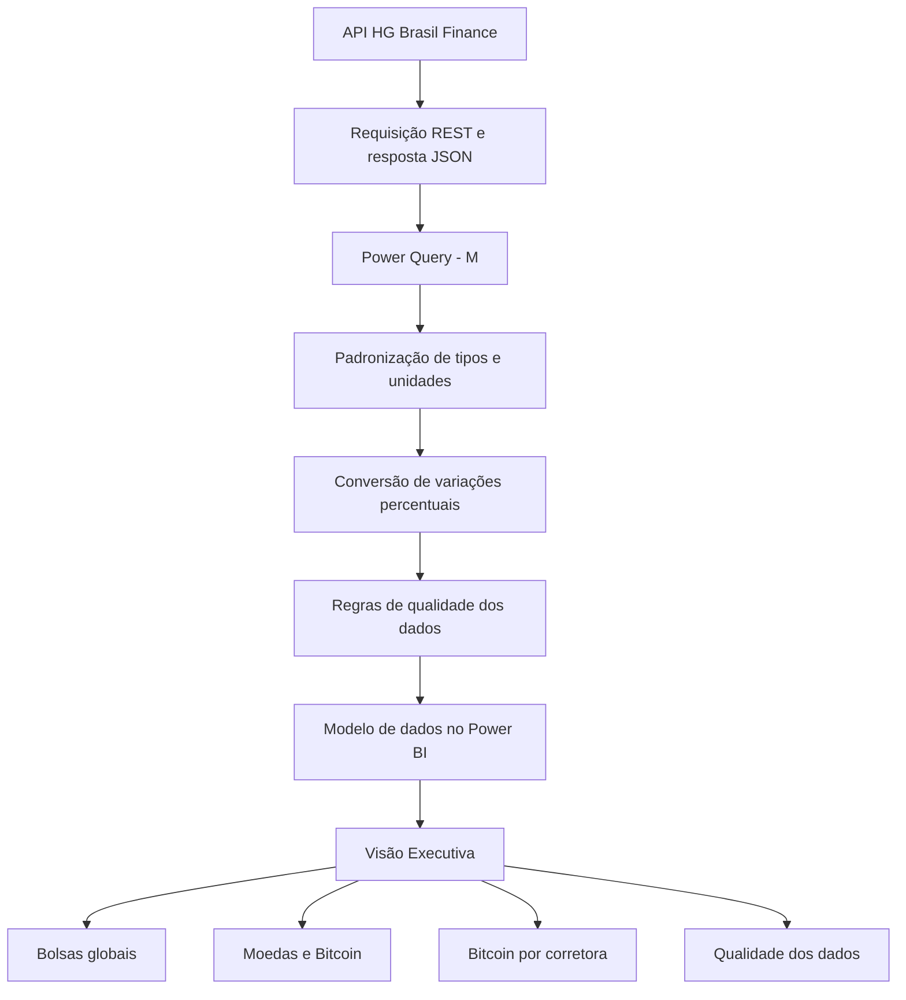

# 📊 Radar Financeiro | Análise de Mercado com Power BI

**Dashboard de Business Intelligence integrado à API HG Brasil Finance para monitoramento de indicadores financeiros e validação da qualidade dos dados.**


## 🎯 Sobre o projeto

Como transformar informações financeiras provenientes de uma API em indicadores claros, organizados e confiáveis?

O **Radar Financeiro** foi desenvolvido para centralizar cotações e variações de diferentes ativos em um dashboard interativo no Power BI. A solução utiliza dados da API HG Brasil Finance e realiza tratamento, padronização e validação das informações antes da apresentação visual.

## 📌 Principais resultados

| Indicador | Resultado |
|---|---:|
| Registros processados | 19 |
| Cotações de moedas e Bitcoin | 9 |
| Índices de bolsas globais | 6 |
| Corretoras de Bitcoin | 4 |
| Registros classificados como OK | 18 |
| Registros sinalizados para revisão | 1 |

**Qualidade dos dados:** 94,74% dos registros foram classificados como OK; 5,26% apresentaram um spread inconsistente e foram sinalizados para revisão.

## 🛠️ Tecnologias utilizadas

- **Power BI Desktop:** criação do relatório e dos visuais interativos.
- **Power Query (linguagem M):** integração, transformação e validação dos dados.
- **API REST — HG Brasil Finance:** fonte dos indicadores financeiros.
- **JSON:** formato de resposta da API.
- **GitHub:** versionamento e documentação.

## 🔄 Fluxo de dados



## 📈 Análises desenvolvidas

### Bolsas globais
Comparação da variação percentual de seis índices: **IBOVESPA, IFIX, CAC, Dow Jones, Nikkei e Nasdaq**.

### Moedas e Bitcoin
Visualização das variações percentuais de nove cotações de moedas e Bitcoin para comparação de movimentos entre ativos.

### Bitcoin por corretora
Comparação das variações percentuais em quatro fontes: **Mercado Bitcoin, Foxbit, Blockchain.info e Bitstamp**.

### Qualidade dos dados
Aplicação de regras de validação para sinalizar registros potencialmente inconsistentes. Entre os 19 registros, **um apresentou spread inconsistente**, exigindo revisão antes de sua interpretação.

## 💡 Competências demonstradas

- Integração com APIs REST e processamento de JSON.
- Transformações e padronização de dados com Power Query (M).
- Conversão e interpretação de variações percentuais.
- Definição de regras de validação e qualidade de dados.
- Visualização e comunicação de indicadores financeiros no Power BI.

## 📂 Estrutura sugerida do repositório

```text
radar-financeiro-powerbi/
├── README.md
├── dashboard/
│   └── radar-financeiro.pbix
├── images/
│   └── dashboard-preview.png
└── docs/
    └── metodologia.md
```

> Adicione os arquivos e pastas acima conforme estiverem disponíveis. A imagem do topo aparecerá quando `images/dashboard-preview.png` for incluída no repositório.

## 🚀 Como executar

1. Instale o **Power BI Desktop**.
2. Baixe e abra o arquivo `.pbix` disponibilizado na pasta `dashboard`.
3. Configure a conexão e as credenciais da API HG Brasil Finance, se necessário.
4. Atualize as consultas para obter os dados disponíveis na fonte.
5. Acesse a página **Visão Executiva** para explorar os indicadores.

**Segurança:** não publique chaves de API, tokens ou outras credenciais no GitHub.

## ⚠️ Limitações

O dashboard apresenta um **retrato do mercado**, com variações em relação à última hora útil anterior, conforme informado na fonte. **Não há armazenamento de histórico** no escopo descrito; portanto, os gráficos não devem ser interpretados como análise de tendências de longo prazo.

As informações têm finalidade educacional e analítica e **não constituem recomendação de investimento**.

---

*Projeto de portfólio — Business Intelligence · Power BI · API REST · Qualidade de Dados*
